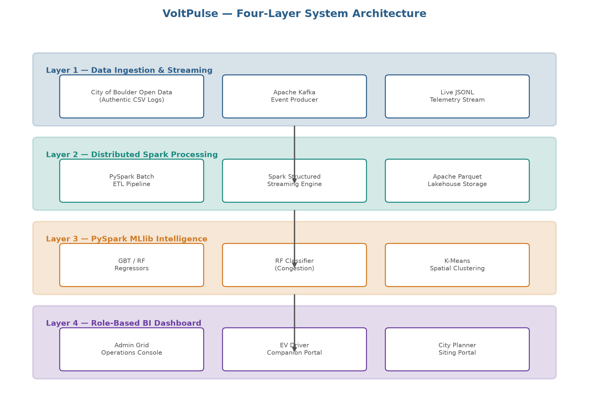
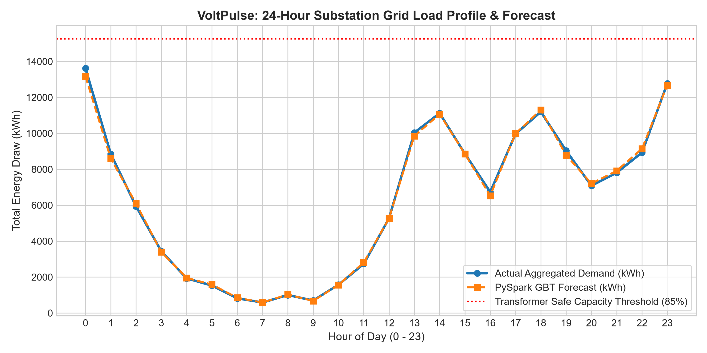
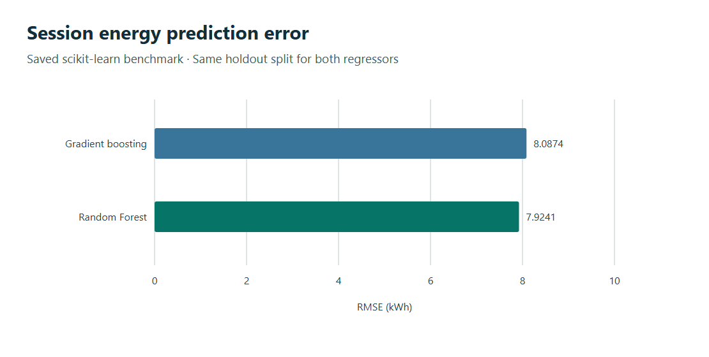
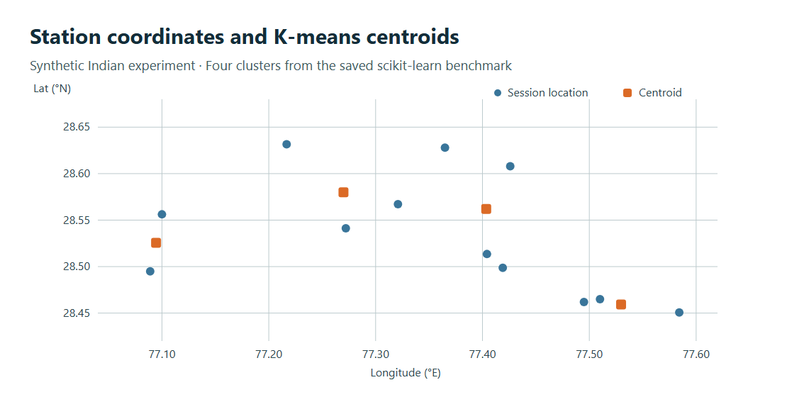

# VoltPulse — EV Charging Big Data Analytics & Grid Intelligence

**VoltPulse** is an end-to-end Big Data analytics platform and interactive web portal for Electric Vehicle (EV) charging infrastructure, grid load forecasting, and municipal hub planning in India.

It combines **Apache Spark (PySpark SQL & MLlib)**, **Apache Kafka** real-time telemetry streaming, **5 Machine Learning models**, a **5-page Power BI semantic model**, and a **3-workspace web application** backed by **1,859 mapped Indian charging stations** and live **Open-Meteo** weather/solar telemetry.

---

## Key Capabilities

### 1. Interactive Web Portal (`src/web/`)
- **EV Commuter (`#driver`):**
  - Search nearby charging stations across India (city search or GPS) with interactive Leaflet maps and Google Maps directions.
  - Estimate charging time and cost based on battery SoC %, charger power (kW), and tariff.
  - Plan inter-city EV trips with route distance and suggested charging stops (Open-Meteo Geocoding + OSRM Routing).
  - Check expected station congestion (`Low` / `Moderate` / `High`) by hour of day and connector type.
- **Grid Operator (`#grid`):**
  - **Charging Shift Planner:** Calculate simultaneous chargers and charging waves within a site's kW power limit.
  - **Live Apache Kafka Stream Monitor:** Real-time power draw aggregation, port occupancy tracking, and `> 45 kW` overload alerts from `voltpulse-ev-telemetry` (with automatic local JSONL fallback when no broker is running).
  - **Live City Grid & Solar Conditions:** Real-time ambient temperature, humidity, wind speed, and solar irradiance (`W/m²`) + 12-hour forecast via Open-Meteo Forecast API.
  - **India Electricity Balance & Hourly Load Profile:** National peak demand/supply context (FY 2021–25) and 24-hour session energy distribution.
- **Municipal Planner (`#municipal`):**
  - Explore mapped charging stations within 15 km of any Indian city.
  - **Multi-City K-Means Optimal Hub Siting:** Run spatial clustering (`K = 2..6`) on mapped stations for any Indian city (or inspect the saved Delhi-NCR benchmark) with live Silhouette Score, WSSSE Inertia, and map-plotted hub centroids.

---

## System Architecture



| Layer | Technology | Purpose |
|---|---|---|
| **Batch ETL & Feature Engineering** | PySpark SQL (`SparkSession`) + Python fallback | Cleans 5,000 sessions; engineers `Hour`, `DayOfWeek`, `IsWeekend`, `IsDCFC`, `Congestion_Level` |
| **Streaming Ingestion** | Apache Kafka 3.9.0 (KRaft) + `kafka-python` | Streams EV charger telemetry (`voltpulse-ev-telemetry`) & live weather (`voltpulse-weather-telemetry`) |
| **Stream Analytics** | Python / KafkaConsumer (`spark_stream_consumer.py`) | Aggregates live kW draw, occupied ports, `> 45 kW` overload alerts, and solar/thermal stress |
| **Machine Learning** | PySpark MLlib & scikit-learn | 5 models covering Regression, Classification, and Spatial Clustering |
| **Business Intelligence** | Power BI (`.pbip`, Power Query M, 7 DAX measures) | 5 report pages, 24 visuals across 13 chart types (`PowerBI/Charts-preview.html`) |
| **Web Application** | HTML/CSS/JS, Leaflet.js, Python Threaded HTTP Server | Serves portal UI + `/api/stream` & `/api/stream/produce` live Kafka APIs |

---

## Machine Learning Models & Benchmarks

All 5 models are implemented in both **PySpark MLlib** ([`train_pyspark_mllib.py`](src/models/train_pyspark_mllib.py)) and **scikit-learn** ([`train_all_models.py`](src/models/train_all_models.py)) using an `80/20` train-test split (`seed=42`).

| # | Model | Portal / Use Case | scikit-learn Benchmark | PySpark MLlib Run |
|---|---|---|---|---|
| 1 | **GBT Regressor** | Grid Load Forecasting (`Energy_kWh`) | RMSE `8.0874` · R² `0.3332` | RMSE `8.0332` · R² `0.3633` |
| 2 | **Random Forest Regressor** | Grid Load Benchmark (`Energy_kWh`) | RMSE `7.9241` · R² `0.3599` | RMSE `7.8002` · R² `0.3997` |
| 3 | **Random Forest Classifier** | Station Congestion (`Low`/`Mod`/`High`) | Accuracy `96.30%` · F1 `0.9620` | Accuracy `98.23%` · F1 `0.9821` |
| 4 | **Linear Regression** | Session Duration (`Charging_Mins`) | RMSE `23.9893` · R² `0.8237` | RMSE `23.1636` · R² `0.8364` |
| 5 | **K-Means Clustering (`K=4`)** | Optimal Charging Hub Siting | Silhouette `0.4445` · Inertia `0.0314` | Silhouette `0.6838` |

---

## Visual Outputs & Dashboards

| Hourly Load Profile | Model Comparison | Spatial Hub Centroids |
|---|---|---|
|  |  |  |

- **Power BI Project:** Open [`PowerBI/VoltPulse.pbip`](PowerBI/VoltPulse.pbip) in Power BI Desktop, or view [`PowerBI/Charts-preview.html`](PowerBI/Charts-preview.html) directly in any browser.

---

## Quick Start

### 1. Install Dependencies
```powershell
python -m pip install -r requirements.txt
```

### 2. Run the Web Portal
```powershell
python src/web/server.py
```
Open **http://localhost:3000** in your browser (or double-click `Run-VoltPulse.bat`).

### 3. Run ETL, ML & Plots Pipeline
```powershell
# Run ETL (PySpark SQL with automatic Python fallback)
python src/etl/etl_pipeline.py

# Train all 5 models (PySpark MLlib & scikit-learn)
python src/models/train_pyspark_mllib.py
python src/models/train_all_models.py

# Generate analytical charts
python src/dashboard/generate_plots.py
```
Or run the native Spark script directly:
```powershell
.\Run-Spark.ps1
```

### 4. Run Real-Time Streaming (Kafka / JSONL Fallback)
```powershell
# Publish EV telemetry + live Open-Meteo weather snapshot
python src/ingestion/kafka_producer.py

# Consume and aggregate stream + flag >45 kW overload alerts
python src/ingestion/spark_stream_consumer.py
```
*(If a local Apache Kafka broker is running on `localhost:9092`, both scripts and `server.py` automatically stream live through Kafka topics `voltpulse-ev-telemetry` and `voltpulse-weather-telemetry`; otherwise they seamlessly use the local JSONL buffers in `data/streaming/`.)*

---

## Repository Structure

```text
├── src/
│   ├── etl/                 # Dataset generator & PySpark SQL ETL pipeline
│   ├── ingestion/           # Dual-mode Kafka producer & stream consumer
│   ├── models/              # PySpark MLlib & scikit-learn 5-model trainers
│   ├── dashboard/           # Matplotlib analytical chart generator
│   └── web/                 # VoltPulse web portal & live Kafka HTTP server
├── data/
│   ├── raw/                 # Simulated Indian NCR charging sessions (5,000 rows)
│   ├── processed/           # Cleaned dataset, model_metrics.json, and plots/
│   └── streaming/           # Telemetry & weather JSONL stream buffers
├── PowerBI/                 # VoltPulse.pbip report, semantic model & HTML preview
├── report/diagrams/         # Architecture, DFD, ETL & CRISP-DM diagrams
├── extras/                  # Spark run logs and portal/BI screenshots
├── Run-Spark.ps1            # Native PySpark ETL + MLlib runner
├── Run-VoltPulse.bat        # One-click Windows launcher
└── requirements.txt         # Python dependencies
```

---

## Data Attribution
- **Charging Station Directory:** [Open Charge Map India Export](https://github.com/openchargemap/ocm-export/tree/main/data/IN) (CC BY 4.0)
- **Live Weather, Solar & Geocoding:** [Open-Meteo APIs](https://open-meteo.com/en/docs)
- **Road Routing:** [OSRM Project](https://project-osrm.org/)
- **National Electricity Balance:** Ministry of Power (India) published annual figures
