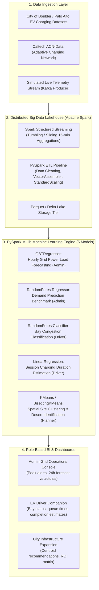

# VoltPulse: A Unified Big Data Analytics & Business Intelligence Platform for Smart EV Charging, Grid Resilience, and Urban Infrastructure Planning

VoltPulse is an enterprise-grade Big Data and Artificial Intelligence platform designed to address the multifaceted challenges of electric vehicle (EV) charging infrastructure. It unifies distributed streaming data pipelines, scalable machine learning, and multi-persona business intelligence into a cohesive ecosystem.

---

## 📌 Executive Summary & Motivation
With the exponential adoption of electric vehicles, unmanaged simultaneous charging threatens power grid stability through severe load spikes and transformer overload. Simultaneously, EV drivers suffer from range and charging anxiety due to unpredictable bay congestion, while municipal planners struggle with suboptimal capital deployment for new charging stations.

VoltPulse resolves these challenges through a unified 3-tier architecture:
1. **Admin / Grid Operations Console:** Real-time telemetry monitoring, transformer headroom protection, and hourly power demand forecasting using distributed gradient boosted trees.
2. **EV Driver Companion Portal:** Live bay occupancy tracking, classification of queue congestion levels, and predictive charging session completion times.
3. **Urban Infrastructure & City Planner Portal:** Spatial clustering using K-Means and density analysis to eliminate charging deserts and identify optimal future hub locations.

---

## 🎯 United Nations Sustainable Development Goals (SDGs)
- **SDG 7 (Affordable and Clean Energy):** Optimizing renewable power dispatch and grid stability for clean mobility.
- **SDG 11 (Sustainable Cities and Communities):** Providing equitable, data-driven access to EV charging infrastructure across urban wards.
- **SDG 13 (Climate Action):** Accelerating the decarbonization of transportation through efficient charging infrastructure.

---

## 🏗️ System Architecture



---

## 🤖 Machine Learning Models (`pyspark.ml`)

| # | Model | Module | Task | Target Metric |
|---|---|---|---|---|
| **1** | `GBTRegressor` | Admin / Grid Console | Forecast next-hour energy demand ($kWh$) | RMSE, MAE, $R^2$ |
| **2** | `RandomForestRegressor` | Admin / Grid Console | Benchmark comparison against GBT | RMSE, MAE, $R^2$ |
| **3** | `RandomForestClassifier` | Driver Companion | Predict station congestion (Free vs. Moderate vs. High) | Accuracy, F1-Score, AUC-ROC |
| **4** | `LinearRegression` | Driver Companion | Predict individual session charging duration (minutes) | RMSE, MAE, $R^2$ |
| **5** | `KMeans` | City Planner | Spatial clustering of high-demand areas for new charging hubs | Silhouette Score, WSSSE |

---

## 📂 Project Repository Structure
```
bigdata_project/
├── data/
│   ├── raw/                 # Authentic datasets (Boulder/Palo Alto/Caltech)
│   ├── processed/           # Transformed Parquet lakehouse tables
│   └── streaming/           # Live streaming event buffers
├── docs/
│   ├── PROJECT_SPEC.md      # Detailed academic specification & rubric alignment
│   └── ARCHITECTURE.md     # In-depth system design & schema documentation
├── src/
│   ├── ingestion/           # Kafka producer simulation & Spark streaming consumers
│   │   ├── kafka_producer.py
│   │   └── spark_stream_consumer.py
│   ├── etl/                 # PySpark batch ETL & feature engineering
│   │   ├── cleaning.py
│   │   └── feature_engineering.py
│   ├── models/              # The 5 PySpark MLlib models
│   │   ├── train_grid_load_gbt.py
│   │   ├── train_grid_load_rf.py
│   │   ├── train_congestion_classifier.py
│   │   ├── train_duration_regressor.py
│   │   └── train_spatial_clustering.py
│   └── dashboard/           # Unified multi-persona dashboard app
│       └── app.py
├── notebooks/               # Jupyter / PySpark exploratory data analysis
│   └── 01_eda_and_profiling.ipynb
├── report/                  # Project report chapters (LaTeX / Word / Markdown)
│   ├── Chapter1_Introduction.md
│   ├── Chapter2_Literature_Review.md
│   ├── Chapter3_Methodology_Design.md
│   ├── Chapter4_Implementation_Results.md
│   └── Chapter5_Conclusion_FutureWork.md
└── requirements.txt
```

---

## 📅 Evaluation Milestone Deliverables
- **Milestone 1 (Week Oct 12–16):** Chapters 1 & 2 Report (minimum 20 pages) covering problem understanding, literature review, project feasibility, objectives, and algorithmic relevance.
- **Milestone 2 (Oct 26–29):** Working PySpark implementation, live streaming demonstration, ML comparative evaluations, viva voce, and Chapters 3 & 4 (pages 23–42).
- **Milestone 3 (Nov 16–20):** Final comprehensive report (Chapters 1–5, 45–50 pages), complete source code, dataset archives, test screenshots, and presentation slides.

