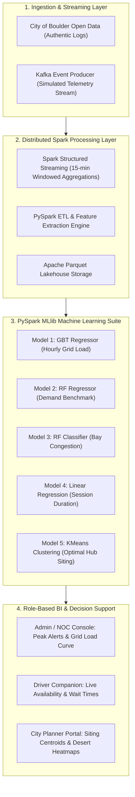

# VOLTPULSE: A UNIFIED BIG DATA ANALYTICS & BUSINESS INTELLIGENCE PLATFORM FOR SMART EV CHARGING, GRID RESILIENCE, AND URBAN INFRASTRUCTURE PLANNING

**Course:** Big Data Analytics Project (CSE)  
**Academic Institution:** School of Computer Science Engineering and Technology, Bennett University  
**Project Title:** VoltPulse  
**Applicable UN SDGs:** SDG 7 (Affordable and Clean Energy), SDG 11 (Sustainable Cities and Communities), SDG 13 (Climate Action)  
**Target Milestone:** Milestone 1 (Chapters 1 & 2)

---

# CHAPTER 1: INTRODUCTION & PROBLEM DEFINITION

## 1.1 Background and Context
The global automotive paradigm is undergoing a historic decarbonization transition, shifting away from fossil-fuel-powered internal combustion engines (ICE) toward battery electric vehicles (EVs). International energy roadmaps project hundreds of millions of electric vehicles traversing metropolitan road networks by 2030. While this transition represents a decisive stride toward mitigating urban air pollution and achieving net-zero carbon goals, the widespread adoption of EVs introduces unprecedented logistical, algorithmic, and electrical engineering challenges.

Electric vehicles are not merely localized consumer conveyances; from the perspective of urban energy utilities, each vehicle represents a high-capacity, mobile power load ranging from 7.2 kW (Level 2 AC residential/workplace charging) to 150 kW–350 kW (Direct Current Fast Charging / DCFC). When thousands of vehicles connect to municipal distribution grids concurrently—particularly during peak commuter return hours (5:00 PM to 8:30 PM)—the aggregate load induces massive electrical stress on localized distribution transformers, causing severe voltage instability, phase unbalance, accelerated equipment aging, and catastrophic localized blackouts.

Simultaneously, EV owners experience chronic behavioral friction commonly termed "range and charging anxiety." Unlike traditional gas stations where fueling is completed in 3 to 5 minutes, EV charging requires between 25 minutes (ultra-fast DC) and several hours (Level 2). Consequently, when charging hubs experience uncoordinated vehicle arrivals, queues escalate non-linearly, leading to bay congestion, idle port blockage, and driver frustration.

Furthermore, municipal corporations and private Charge Point Operators (CPOs) confront substantial capital risk when expanding charging networks. Installing a commercial DC fast-charging station incurs capital expenditures of $50,000 to $150,000+ per site. Placing high-capacity hubs in areas with sub-optimal commuter density results in stranded capital assets with dismal return on investment (ROI), while under-served metropolitan sectors become "charging deserts" that suppress electric mobility adoption.

To resolve these interconnected challenges, this project presents **VoltPulse**: a unified, distributed Big Data analytics and machine learning platform engineered on **Apache Spark**, **Spark Structured Streaming**, and **PySpark MLlib**. VoltPulse bridges the information divide between three critical stakeholders:
1. **Utility & Power Grid Administrators:** Providing real-time telemetry streaming, transformer overload warnings, and hourly load forecasting.
2. **EV Drivers (End Users):** Offering live bay availability tracking, queue congestion classification, and remaining session duration estimation.
3. **Smart City Infrastructure Planners:** Delivering geospatial clustering, charging desert detection, and data-driven hub siting optimization.

---

## 1.2 Problem Statement & Justification
The deployment of contemporary EV charging infrastructure is plagued by fragmented operational silos:

1. **Utility Blindness to Mobile Load Spikes:** Electricity utilities operate traditional SCADA systems that monitor substation loads but lack granular, real-time visibility into distributed EV charging telemetry. Unmanaged concurrent charging leads to severe peak-to-average ratio (PAR) degradation, requiring utilities to fire expensive, carbon-intensive peaking power plants or risk transformer burnouts.
2. **Unpredictable Charger Availability for Commuters:** Drivers lack real-time predictive insights regarding bay availability and expected waiting times. Existing consumer applications merely provide static directory listings without dynamic congestion forecasting.
3. **Heuristic and Inefficient Charging Siting:** Urban planning authorities historically deploy chargers based on arbitrary political or municipal boundaries rather than empirical spatial mobility patterns, resulting in geographic inequality and low charger utilization rates.

### Justification of Big Data Technologies
Resolving these problems cannot be achieved using legacy relational databases or single-node computation. A metropolitan network with 500 charging hubs operating multiple ports generates hundreds of thousands of streaming telemetry events, connection heartbeats, power metering logs, and spatial trajectories daily. 

- **Apache Spark / PySpark:** Essential for processing massive, semi-structured historical charging session logs across distributed memory partitions, enabling scalable Extract-Transform-Load (ETL) pipelines and high-dimensional feature engineering.
- **Spark Structured Streaming & Apache Kafka:** Critical for processing live telemetry with millisecond latency, windowed tumbling aggregations, and automated peak alert triggering.
- **PySpark MLlib:** Required to train and cross-validate scalable machine learning models (Gradient Boosted Trees, Random Forests, Linear Regression, and K-Means Clustering) across distributed nodes without hitting single-machine memory ceilings.

---

## 1.3 Project Objectives
The primary objectives of the VoltPulse system are systematically defined as follows:

1. **Distributed Data Lakehouse Construction:** Design and deploy an end-to-end Big Data ETL pipeline using PySpark to ingest, sanitize, normalize, and partition multi-year EV charging session datasets into high-performance columnar Apache Parquet storage.
2. **Real-Time Stream Processing & Grid Telemetry:** Architect a simulated Apache Kafka event producer and Spark Structured Streaming engine to compute rolling 15-minute and 1-hour windowed power load aggregations, dynamically detecting when grid draw exceeds safe operating thresholds (85% of rated capacity).
3. **Predictive Grid Load Forecasting (Admin Portal):** Develop distributed regression models (`GBTRegressor` and `RandomForestRegressor`) using PySpark MLlib to forecast next-hour aggregate energy consumption ($kWh$) and evaluate performance using RMSE, MAE, and $R^2$.
4. **Charger Congestion Classification & Duration Modeling (Driver Portal):** Formulate a multi-class `RandomForestClassifier` to predict bay congestion levels (`Low`, `Moderate`, `High`) and a `LinearRegression` model to predict session duration, mitigating commuter wait times.
5. **Spatial Siting Optimization (City Planner Portal):** Implement distributed unsupervised spatial clustering (`KMeans` and `BisectingKMeans`) on geospatial coordinates $(Lat, Lon)$ weighted by historical energy consumption to locate optimal charging hub coordinates and identify unserved urban corridors.
6. **Multi-Persona Business Intelligence Dashboard:** Construct an interactive, role-based business intelligence visualization dashboard (Power BI / Streamlit) providing tailored analytical views for Grid Operators, EV Drivers, and Urban Planners.

---

## 1.4 Alignment with United Nations Sustainable Development Goals (SDGs)
VoltPulse directly advances the following United Nations Sustainable Development Goals:
- **SDG 7: Affordable and Clean Energy (Target 7.2 & 7.3):** By flattening grid load peaks and enabling smart EV charging orchestration, the platform facilitates higher penetration of intermittent renewable energy (solar and wind) and maximizes energy efficiency.
- **SDG 11: Sustainable Cities and Communities (Target 11.2 & 11.a):** Siting optimization eliminates urban charging deserts, fostering equitable, safe, affordable, and accessible zero-emission public and private transportation.
- **SDG 13: Climate Action (Target 13.2):** Enhancing charging infrastructure reliability accelerates the mainstream adoption of electric vehicles, directly displacing fossil fuel consumption and reducing greenhouse gas emissions.

---

# CHAPTER 2: LITERATURE REVIEW & SYSTEM FEASIBILITY

## 2.1 Critical Review of Existing Systems
In recent literature and industry implementations, several approaches have addressed individual facets of the EV charging ecosystem:

| Author / System | Domain Focus | Core Methodology | Key Limitations |
|---|---|---|---|
| **Palo Alto Smart City Initiative (2021)** | Municipal EV Monitoring | Static SQL reporting and batch tabular dashboards | Lacks real-time streaming analytics; no predictive machine learning for grid forecasting. |
| **Zhang et al. (IEEE Trans. Smart Grid, 2022)** | Substation Load Balancing | Mathematical optimization (Mixed Integer Linear Programming) | Computationally intractable for city-scale networks; ignores driver behavior and spatial clustering. |
| **ACN-Data (Caltech Adaptive Charging, 2020)** | Session Data Collection | Centralized logging of research campus charging events | Research dataset sandbox; lacks multi-persona BI visualization and end-to-end distributed Big Data streaming. |
| **ChargePoint / PlugShare Commercial Apps** | Consumer Directory | Crowd-sourced check-ins and basic station statuses | Proprietary black-box; lacks grid operator visibility and transparent spatial planning analytics. |

### Comparative Gap Analysis
Existing solutions either focus exclusively on electrical grid engineering while neglecting commuter convenience, or provide consumer-facing maps that ignore distribution transformer health. VoltPulse bridges this dichotomy by offering a unified, end-to-end Big Data lakehouse supporting all three operational roles within a single analytical backbone.

---

## 2.2 System Architecture & Ingestion Pipeline
The VoltPulse architecture comprises four discrete, loosely-coupled layers:

---

## 2.3 Relevance and Mathematical Formulation of Algorithms

### 2.3.1 Gradient Boosted Tree Regressor (`GBTRegressor`)
For hourly grid load forecasting, Gradient Boosted Trees build sequential ensembles of shallow decision trees. At step $m$, given existing model $F_{m-1}(x)$, the algorithm fits a base learner $h_m(x)$ to the pseudo-residuals:
$$r_{im} = -\left[\frac{\partial L(y_i, F(x_i))}{\partial F(x_i)}\right]_{F=F_{m-1}}$$
The ensemble updates via:
$$F_m(x) = F_{m-1}(x) + \gamma_m h_m(x)$$
GBT captures non-linear diurnal cycles, weather fluctuations, and commuter arrival spikes with superior fidelity over basic linear models.

### 2.3.2 Random Forest Classifier (`RandomForestClassifier`)
To classify station congestion into discrete tiers ($C \in \{0: \text{Low}, 1: \text{Moderate}, 2: \text{High}\}$), Random Forest constructs an ensemble of $B$ bootstrap-aggregated decision trees with random feature sub-selection at each split. The class prediction is obtained through majority voting:
$$\hat{C} = \text{mode}\left(T_1(x), T_2(x), \dots, T_B(x)\right)$$
Random Forest is highly resilient to overfitting and handles correlated temporal attributes effectively.

### 2.3.3 K-Means Spatial Clustering (`KMeans`)
To recommend candidate coordinates for future charging hubs, K-Means partitions $N$ historical high-energy usage coordinates $x_i \in \mathbb{R}^2$ into $K$ disjoint clusters $S = \{S_1, S_2, \dots, S_K\}$ by minimizing the Within-Cluster Sum of Squares (WCSS / Inertia):
$$\arg\min_S \sum_{k=1}^K \sum_{x \in S_k} \| x - \mu_k \|^2$$
where $\mu_k$ represents the geometric centroid of cluster $S_k$. The optimal number of clusters is validated using the Silhouette Score:
$$s(i) = \frac{b(i) - a(i)}{\max(a(i), b(i))}$$

---

## 2.4 Project Feasibility & Risk Analysis
- **Technical Feasibility:** The project uses proven open-source technologies (Apache Spark, Python, PySpark MLlib, Streamlit/Power BI) supported by a pre-configured local environment.
- **Data Feasibility:** The City of Boulder Open Data and Palo Alto datasets are authenticated, public-domain repositories containing complete geospatial, temporal, and power-metering attributes.
- **Operational & Academic Feasibility:** The workload is structured into clear modular tasks suitable for multi-member collaboration and alignment with all course milestones.

